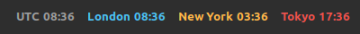
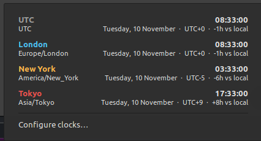
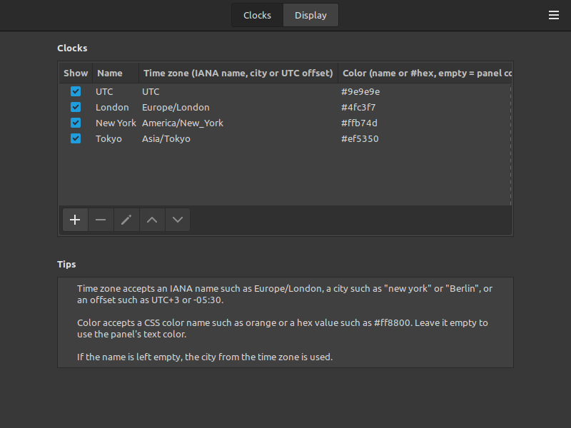

# Zone Clocks — multiple time zone clocks for the Cinnamon panel

A [Cinnamon](https://github.com/linuxmint/cinnamon) applet for Linux Mint that
shows several clocks for different time zones side by side in the panel.
Each clock has its own name, time zone and color. Clocks can be added, edited,
removed, reordered and hidden from the applet settings.



## Features

- Any number of clocks, each with a name, time zone and color.
- Add / edit / remove / reorder clocks from the settings dialog
  (right-click the applet → **Configure…**).
- Time zone input accepts an IANA name (`Europe/London`), a city
  (`new york`, `Berlin`, `Tokyo`), common aliases (`NYC`, `Beijing`) or a
  UTC offset (`UTC+3`, `-05:30`).
- Color is any CSS color name (`orange`) or hex value (`#ff8800`); it can be
  applied to name and time, to the name only, or shown as a colored dot.
- 12/24-hour format (or follow the system setting), optional seconds,
  optional custom `strftime` format.
- Clocks that are already on the next or previous day get a `+1d` / `-1d` marker.
- Hover for a tooltip with every clock; click for a popup with full date,
  UTC offset and the difference to local time.
- Works in horizontal and vertical panels; multiple instances allowed.

| Popup | Settings |
|-------|----------|
|  |  |

## Requirements

Linux Mint with Cinnamon 5.0 or newer (tested on Mint 21.3, Cinnamon 6.0).
No extra packages are needed.

## Install

```bash
git clone https://github.com/<your-user>/cinnamon-zone-clocks.git
cd cinnamon-zone-clocks
./install.sh            # copy into ~/.local/share/cinnamon/applets
./install.sh --enable   # ...and add it to the right side of the main panel
```

Without `--enable`: right-click the panel → **Applets** → find **Zone Clocks**
→ click **+** to add it to the panel.

To uninstall: right-click the applet → **Remove**, then delete
`~/.local/share/cinnamon/applets/zoneclocks@skde`.

## Configure

Right-click the applet → **Configure…**

**Clocks** tab: the list of clocks. Use **+** to add, the pencil to edit,
**−** to remove, the arrows to reorder. Each row has:

| Column    | Meaning                                                              |
|-----------|----------------------------------------------------------------------|
| Show      | Untick to hide a clock without deleting it                           |
| Name      | Label shown before the time. Empty = city taken from the time zone   |
| Time zone | `Europe/London`, `new york`, `UTC+3`, `-05:30`, …                    |
| Color     | `orange`, `#ff8800`, … Empty = normal panel text color               |

**Display** tab: hour format, seconds, day marker, custom format, whether
names are shown, how the color is applied and the spacing between clocks.

An unknown time zone shows `?` instead of the time; the tooltip and popup
tell you which entry is wrong.

## Development

```bash
./install.sh --link          # symlink the source dir so edits are live
./install.sh                 # re-run after edits: it reloads the applet via DBus
tail -f ~/.xsession-errors   # Cinnamon logs JS errors here (also Looking Glass: Alt+F2, lg)
```

Files in `zoneclocks@skde/`:

- `applet.js` — the applet. `ZoneIndex` resolves user input to a `GLib.TimeZone`,
  `ClockItem` is one panel clock, `ClockMenuRow` one popup row,
  `ZoneClocksApplet` ties them together and ticks via `CinnamonDesktop.WallClock`.
- `settings-schema.json` — settings UI; the `clocks` key is a `list` widget whose
  rows are `{enabled, name, timezone, color}` objects.
- `stylesheet.css` — style classes used by the applet.
- `metadata.json` — applet identity.

## License

GPL-2.0-or-later, the license used by Cinnamon applets. See [LICENSE](LICENSE).
